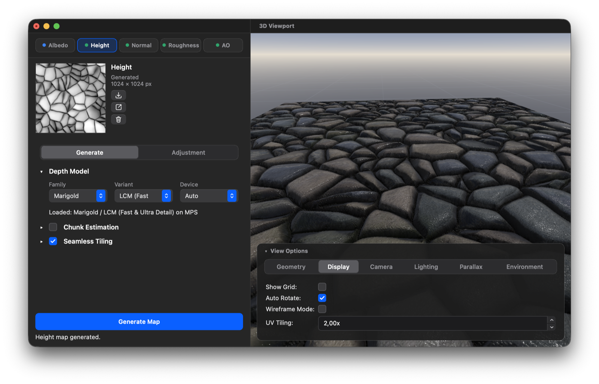
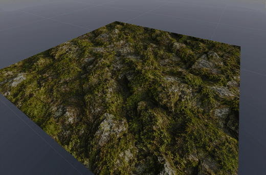
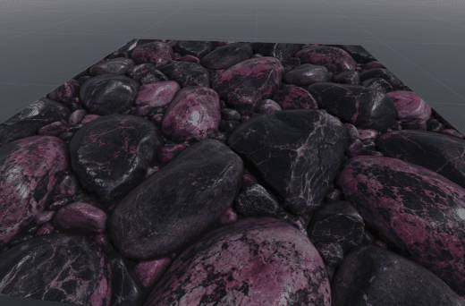
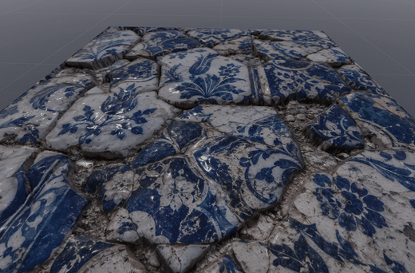

<p align="center">
  
</p>

<h1 align="center">PBRCELAIN</h1>

<p align="center">
  <strong>Turn a single photo into a clean, tileable height map — and a full PBR material around it.</strong>
</p>

<p align="center">
  
  
  
  
</p>

<p align="center">
  <a href="https://github.com/AyberkA0/pbrcelain/releases"></a>
</p>

<p align="center">
  <a href="https://buymeabitcoffee.vercel.app/btc/bc1qhae9un6j8mel5xcrd4trajm65wfunlltkzelh7?identifier=Buy+Me+a+Coffee"></a>
</p>

<p align="center">
  
</p>

PBRCELAIN is a free desktop app that turns an ordinary photo of a surface (stone,
brick, wood, tiles, fabric…) into the texture maps a game engine or 3D renderer
needs: **Height, Normal, Roughness and Ambient Occlusion**. An AI depth model
estimates the relief from the photo, the other maps are built from it, and you see
the result live on a 3D preview.

## Showcase

Materials generated from single photos, previewed in the built-in 3D viewport.

<p align="center">
  <br>
  <em>Mossy ground</em>
</p>

<p align="center">
  <br>
  <em>Strange pebbles</em>
</p>

<p align="center">
  <br>
  <em>Porcelain</em>
</p>

## Download

Ready-to-run builds for **macOS (Apple Silicon)** and **Windows (64-bit)** are on the
[Releases page](https://github.com/AyberkA0/pbrcelain/releases) — no Python needed.
The app itself is a small download; the AI components (about 160 MB) are
downloaded once, the first time you generate a Height map. The Windows build runs
depth models on the CPU; for NVIDIA GPU acceleration, [run it from source](docs/DEVELOPMENT.md).

### First launch on macOS

The app is not notarized by Apple yet, so macOS blocks it the first time:

1. Open the DMG and drag **PBRCELAIN** into **Applications**.
2. Open it once. When macOS says it cannot verify the app, click **Done**.
3. Go to **System Settings › Privacy & Security**, scroll down and click
   **Open Anyway** next to PBRCELAIN, then confirm.

You only need to do this once. If macOS instead says the app **is damaged**, run
this in Terminal and open it again:

```bash
xattr -dr com.apple.quarantine /Applications/PBRCELAIN.app
```

## Getting started

1. **Import a photo** into the Albedo slot (the one that pulses).
2. Select the **Height** slot and click **Generate Height**. The first run
   downloads the AI components and the depth model.
3. Generate **Normal**, **Roughness** and **Ambient Occlusion** the same way, fine-tune them on the
   **Adjustment** page, then use **Export** to write every map to a folder.

Hover over any setting to see what it does. Projects are saved as `.pcln` files that
keep everything, so you can reopen and keep adjusting without re-running the model.

## 4K, 8K and beyond: why not just ask an image AI?

You can ask a general image AI to "make a height map of this photo", and it will
draw something that looks like one. But it works at a fixed, small output size, so
a 4K or 8K photo comes back downscaled and its fine relief is lost, and a picture
that only *looks* plausible is not a measured depth estimate.

PBRCELAIN combines the two approaches. **More Detail with Chunks** runs a dedicated
depth model over the photo in overlapping chunks at the model's native resolution,
then blends them into one map guided by a full-image pass. The output resolution
therefore follows your photo, with no upper limit, as with classic filter-based
height map tools, while the relief comes from an AI depth model and is far more
accurate than what those filters can infer. A 4K photo gives a 4K height map, an 8K
photo an 8K one.

## Which depth model?

- **Depth Anything V2** for deep, uneven surfaces with lots of relief: pebbles,
  gravel, rocks, bark, rubble.
- **Marigold** for flatter, more regular surfaces with a pattern: tiles, pavers,
  brick walls, planks, fabric.

Both are one click away in **Height › Depth Model**; if a result looks off, try the
other one.

## Use from scripts and AI agents

PBRCELAIN also runs without its window, so scripts and LLM agents (Claude Code,
Cursor, Codex…) can generate maps with one command and read a JSON answer:

```bash
PBRCELAIN generate photo.jpg --out maps/
```

No extra setup: it is the same app binary (on macOS,
`/Applications/PBRCELAIN.app/Contents/MacOS/PBRCELAIN`). See the
[command line guide](docs/CLI.md) for every option.

## Learn more

- [How it works](docs/HOW-IT-WORKS.md): the depth models, high-resolution and seamless
  generation, artifact correction, and how each map is derived.
- [Command line](docs/CLI.md): generating maps from scripts and AI agents.
- [Running from source](docs/DEVELOPMENT.md): installing with Python, GPU setup,
  file associations and project file details.

## License

PBRCELAIN is free software under the [GNU General Public License v3.0](LICENSE).

The depth models are downloaded from Hugging Face and come with their own licenses.
**Depth Anything V2 Base and Large are licensed for non-commercial use only**
(CC BY-NC 4.0). For commercial work, use Depth Anything V2 Small (Apache 2.0),
Marigold Fast (Apache 2.0) or Marigold Standard (CreativeML Open RAIL++-M).
